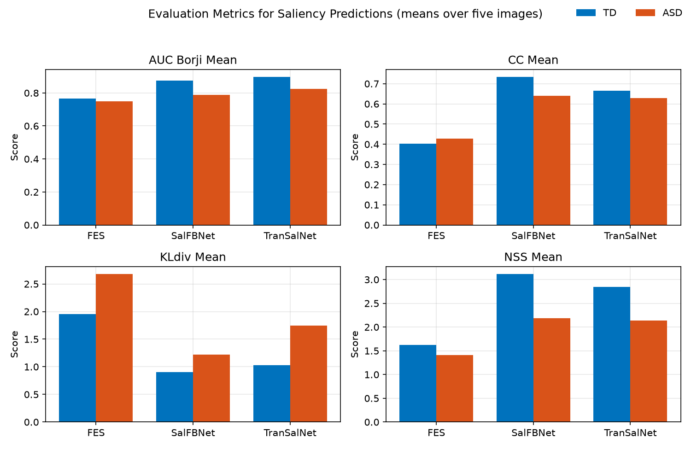

# ASD and TD saliency model comparison

I scored three published saliency models, FES, SalFBNet and TranSalNet, against fixation maps from autistic (ASD) and typically developing (TD) viewers, using four metrics over five images.

FES had the worst mean on every metric in both groups. Five images could not separate the two deep models, so I do not rank them.

## Question

Saliency models are trained on fixation data pooled from TD viewers. How do they score against ASD fixation maps compared with TD maps, and what does each metric count when it scores them?

## Data and models

The images come from `Saliency4asd.zip`, and the group fixation maps from `TrainingData.zip` (`TD_FixMaps` and `ASD_FixMaps`). The results cover five images: 1, 10, 100, 101 and 102.

| Model | Type | Source | How I ran it |
|---|---|---|---|
| FES | Classical hand-designed features | [hrtavakoli/FES](https://github.com/hrtavakoli/FES) | MATLAB, `saliencyPredictionsCode/FES.m` |
| SalFBNet | Feedback-recurrent CNN | [gqding/SalFBNet](https://github.com/gqding/SalFBNet) | PyTorch on Colab, pretrained weights |
| TranSalNet | Transformer-augmented encoder-decoder | [LJOVO/TranSalNet](https://github.com/LJOVO/TranSalNet) | PyTorch on Colab, pretrained weights |

I ran each model's published code and did not retrain or fine-tune anything. The metrics are the MIT Saliency Benchmark MATLAB functions from [cvzoya/saliency](https://github.com/cvzoya/saliency).

## Metrics

| Metric | What it counts | Better |
|---|---|---|
| AUC-Borji | The map as a pixel classifier, with negatives sampled uniformly. Only the ordering of pixel values matters, and centre bias is not corrected. | Higher |
| CC | Pearson correlation with the ground truth. False positives and false negatives cost the same. | Higher |
| KL divergence | Asymmetric. Missing a fixated region costs far more than spreading density over unfixated ones. | Lower |
| NSS | Mean z-normalised saliency at fixated pixels. A raised background lowers it. | Higher |

`evaluate.m` binarises each fixation map with `imbinarize` and passes that map to all four metrics, so CC and KL are computed against a binary map, not a continuous fixation density. Predicted maps are scored as saved, with no extra blur.

## Results

Means over five images, from `Results/TD_summary.csv` and `Results/ASD_summary.csv`.

TD fixation maps:

| Model | AUC-Borji | CC | KL | NSS |
|---|---|---|---|---|
| FES | 0.765 | 0.403 | 1.955 | 1.619 |
| SalFBNet | 0.875 | 0.733 | 0.906 | 3.115 |
| TranSalNet | 0.896 | 0.665 | 1.028 | 2.846 |

ASD fixation maps:

| Model | AUC-Borji | CC | KL | NSS |
|---|---|---|---|---|
| FES | 0.749 | 0.428 | 2.678 | 1.410 |
| SalFBNet | 0.789 | 0.640 | 1.221 | 2.186 |
| TranSalNet | 0.825 | 0.630 | 1.743 | 2.140 |

The summary files also hold standard deviations, and `TD_metrics_<Model>.csv` and `ASD_metrics_<Model>.csv` hold the per-image scores.



## Findings

- FES has the worst mean on every metric in both groups.
- All three models score worse on ASD maps under AUC-Borji, KL and NSS. Under CC the two deep models are worse on ASD maps, and FES is marginally better (0.428 against 0.403).
- SalFBNet and TranSalNet are not separable here. TranSalNet has the higher AUC-Borji, SalFBNet the better CC, KL and NSS, and no gap exceeds about 1.6 standard errors of the per-image differences.

That split fits what each metric counts: AUC-Borji reads only the ordering of pixels, while the others also read the map's magnitude and spread. Five images can illustrate this, not establish it.

## Limitations

- Five images, so every result is descriptive.
- One image moves the ASD KL means: image 100 scores 6.691 for FES and 4.494 for TranSalNet, while no other ASD KL value for those models is above 2.210.
- CC and KL use binarised ground truth, so they are not comparable with scores against continuous density maps.
- AUC-Borji samples negatives at random and no seed is set, so a re-run can shift that column slightly.
- Group-level maps average over viewers. The results say nothing about an individual and do not support diagnostic use.
- This measures how TD-trained models transfer to ASD data, not how to build an ASD-specific model.

## Reproducing

Requirements: MATLAB R2018b or later with the Image Processing Toolbox, `git` on the path and internet access. Colab and Google Drive are needed only to regenerate the deep-model maps.

In MATLAB, with the repository as the current folder:

```matlab
downloadAndUnzip    % TrainingData/ and PredictionMaps/
cloneMetricsCode    % metric functions, added to the path
evaluate            % per-image and summary CSVs in Results/
visualize           % figures in visuals/
```

`evaluate` and `visualize` clear the workspace and overwrite the committed CSVs and figures, so copy those first if you want to keep them.

### Regenerating the saliency maps

Optional, since `downloadAndUnzip` fetches the packaged `PredictionMaps.zip`.

- **FES:** run `saliencyPredictionsCode/FES.m`. It reads `TrainingData/Images`, unpacking `1.zip` there if the folder is missing, and zips its output as `FES.zip`.
- **SalFBNet:** run `saliencyPredictionsCode/SalFBNet.ipynb` on a Colab GPU, with `Saliency4asd.zip` at the top of Drive. Upload `FBNet_Res18Fixed_best_model.pth` when asked.
- **TranSalNet:** run `saliencyPredictionsCode/TranSalNet.ipynb` on a Colab GPU (it fails on CPU), with `Saliency4asd.zip` at the top of Drive and the weights, including `TranSalNet_Res.pth`, in `MyDrive/Saliency/models/TransalNet`.

Put the PNG maps in `PredictionMaps/FES`, `PredictionMaps/SalFBNet` and `PredictionMaps/TranSalNet`. `evaluate.m` treats every subfolder there as a model.

## Licence

Apache License 2.0, see [LICENSE](LICENSE). It covers the code in this repository. The model code and weights, the metric code and the dataset are not included and keep their own terms.
